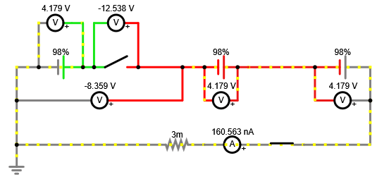
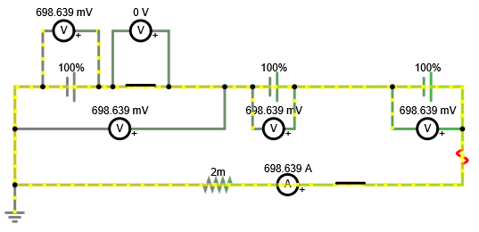
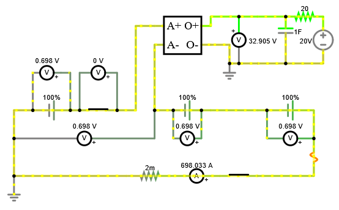

# Falstad_3_cells_in_series
Simple Electrical and electro-thermal simulations for use with the Falstad simulator
The .txt files are for use with the simulator at https://www.falstad.com/circuit/

## falstad-3cells-series-full-meters.txt 
This has 3 li-ion cells in series with a very low resistance load (3 mOhms, almost a short circuit). The switch near the top left cell illustrates what would happen if one of the cell connections fails open circuit (or the cells CID opens). In this case you will see fairly high negative voltages on two of the meters. The numbers starting at 100% above each cell are the cells SOC (State Of Charge).

## falstad-3cells-series-fuse.txt 
This adds a fuse to the circuit - this fuse will go open circuit after a small time due to the very high current flowing.

## falstad-3cells-series-fuse-thermal-model.txt
This file adds a coupled thermal model so the Voltmeter connected to the O+/O- connections (top right) gives an estimate of the cells internal temperature (one volt is 1 deg C). When this simulation is run the cell temperature will rise to just over 45 degC at which point the fuse blows stopping the current and the temperature gradually returns to ambient (20 degC as set by the voltage source top right). The thermal model has a thermal capacitance of 1F representing the thermal mass of the cell and a thermal resistance of 20 K/W to ambient. The square symbol (A+/A-, O+, O-) is a current to current converter which gives an output current from O+ to O- proportional to the square of the current flowing between A+ and A- so simulating Joule heating within the cell.

This schematic can be run directly in falstead via this link https://www.falstad.com/circuit/circuitjs.html?ctz=DwYwlgTgBAZgvAIgIwKgFwM6IAwDpsEECsqYIiSeATAVQOx0DM2AHFQGwCcndqIARoiLZUAB0EJhqAG4QhqALaYhAUwC0SFAD4AUFCjAAQgEM0aFRACeUAB6JGjdlCoAWbFDfvXI2IiqoIbBx8bBIoCCRg7H8oEEiEGgI+Y1E-UgwAe3JkVH40ClRM7JQAel19I1NzK1shOidvKHZXZzdUeASAoIQ8YgD43pi4v0Jk1M6oMCKCqDyZ6ZyyvQMTMwtrOwQmBrcoFiQdnw6YwKjQ-qih+MSfEBS0yYWUWfycqCeEJYroTZdOJ0YRCoUCI9SggJiHR8ch6IX8XwMAHNaghmC5wUDwdh0YwWC52jhPuUDAB3FFo1ruClUFgsAk9InLYBkzYUiEef4YyGEhHMlF0GiUpq7bz0kS80QoogudE0lhY2W0+mMRQqQnvYoBNUM3ks+zY5y0hVcsWMip6yQyoXSxV03w64nADAo9hEAGYgVUoGm3X8wXs-bu7kOpnO34HIUuFheNr28WOyWbZq2kFguXK1XqjCa8LayiEUa+zaBw3ykuiuNmgyJxDlo3bUsZqAKbU+bMzCB5guFx0W0GHEFWitQqt8zb90upw4+3sulqNdgi2MjouIZOT9fDnmzzYNxqeykzpkWvf1xyHyu8gCCChb1Rdbq5U5N9pVzdbhU1EvJeKgSDBDhOP+7BNi2WY5p2FDdkk36-NGf5gi4EbAaBH4ah2H6rqi56NNSy7bse5LnsB4I4fhIbmiiniRhGW4UaSP7oiR1EoZeO6ICxiEEBeK7sQgSFAYhtHkfGhFwe4zHwXRokVAAYgArhgKgoiWAa0Uqla5mczxgFQfjCEkUAABZofwAA2iAwMYZlKaOADCDkAMpSlanLsKwUD-KakzZDEKibMYABUQW9NgpR8Taf40oOsoiaOfauU4RBIMCXlsWJQgpZ5SVZdJ8VSrluxRjGRwERUyJJgKf7uU0VWsbxGUIIuEnRewdU0kelGVcCKXym1PXuZ1DHddV7jsEaBylfRwA-Ig9Rlu4LCMMC0beTCNCjtIKnLaNew7at9quKgJIjs2xg2NIIz5bugqTVA82jUNY5zeNezuAeB0NV1c2CvB40LU9FrNW9wruGlX3DWuRp-bsn1lZDTUTTVB6TU9NaIwtTRI1Nb5gQy6H45ByDQTJBggPyr3wQ9vXeTmYCXQkbYwj40gACZXVh1M1UtA1TaTz1bK9vX3ULg3pRUGRQCoAB2mWFOMi70jYNA0ClYjqgo7NNagmwACoqAoogWKY8mdlAahQAAIioiJ2agaDjPmBYIMSFSSgzbbZAdChYJIijjGoiSjiUGS6MAJTgBAuhAA

Click on the link and the simulation will automatically start. 

Note this has a scope display added to show the temperature.
